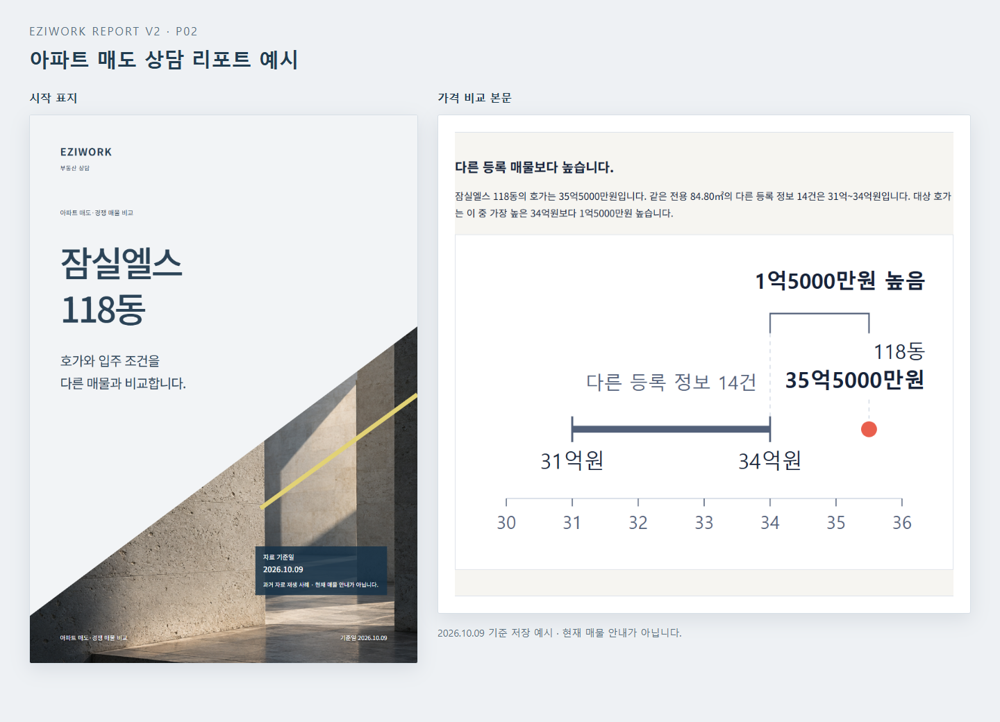

# Real Estate Report

**고객의 부동산 질문을, 근거와 비교가 담긴 HTML·PDF 상담 리포트로 만듭니다.**

아파트 매수·매도부터 전세·월세, 상가·토지, 임대 운영까지 **14종 부동산 상담 리포트**를 만드는 Codex 스킬입니다. 자연어로 질문하고 필요한 자료를 제공하면, Codex가 자료를 검토하고 고객에게 설명할 문장과 시각자료를 작성해 HTML과 PDF로 정리합니다.

**현재 배포 버전: 2.3.2** · **실행 환경: Codex** · **출력: HTML + PDF**

새 고객 보고서는 공공데이터포털·VWorld·KOSIS·R-ONE·ECOS **5개 키를 모두 등록한 뒤** 시작합니다. 실제 호출은 고객 질문에 필요한 출처만 수행합니다. key-env ensure는 기존 키를 재사용하고 누락 키만 별표·글자 수가 표시되는 별도 입력 창에서 받아 Windows 사용자 환경변수 또는 Mac 전용 저장소에 저장합니다. 주소는 VWorld, 학교·법령은 공식 공개자료를 사용합니다. [설정 방법](references/api-setup.md) · [2.3.0 검증 범위](qa/migration-2.3.0.md)

[결과 예시](#결과-예시) · [14종 리포트](#14종-리포트) · [설치](#설치) · [키 없이 첫 출력](#api-키-없이-첫-출력-확인) · [자료 설정](#자료와-api-설정) · [이용 조건](#이용-조건)

## 이런 상담에 사용합니다

- **매수 고객:** 후보 매물의 가격과 입주 조건을 비교하고 싶을 때
- **매도 고객:** 내 매물의 희망 가격을 실거래·현재 등록 매물과 비교하고 싶을 때
- **임차 고객:** 보증금·월세·관리비·계약 조건을 함께 확인하고 싶을 때
- **상가·토지 고객:** 임차·매수·이용 조건과 사업 가정을 검토하고 싶을 때
- **임대인:** 수금·미수금·지출·계약 만료를 월간 보고서로 정리하고 싶을 때

## 결과 예시

*P02에 저장된 2026.10.09 기준 예시의 표지와 본문입니다. 현재 매물 안내가 아니며, 표지의 건축 이미지는 대상 매물의 사진이 아닙니다.*

| 예시 | HTML | PDF |
|---|---|---|
| 아파트 매수·후보 비교 | [P01 보기](examples/P01/report-2.2.0.html) | [P01 보기](examples/P01/report-2.2.0.pdf) |
| 아파트 매도·경쟁 매물 비교 | [P02 보기](examples/P02/report-2.2.0.html) | [P02 보기](examples/P02/report-2.2.0.pdf) |
| 주거 월세 총비용·계약 비교 | [P05 보기](examples/P05/report-2.2.0.html) | [P05 보기](examples/P05/report-2.2.0.pdf) |
| 임대자산 월간 운영 보고 | [P13 보기](examples/P13/report-2.2.0.html) | [P13 보기](examples/P13/report-2.2.0.pdf) |

GitHub에서는 HTML 링크가 소스 화면으로 열립니다. 완성본은 PDF로 확인하거나, 저장소를 내려받아 HTML을 브라우저에서 여세요. HTML과 함께 상대 경로의 자산 파일도 유지해야 합니다.

저장된 사례는 기준일의 자료를 재생한 예시이고, 설치 확인용 자료는 합성값입니다. 이를 새로 수집한 현재 자료로 표시하지 않습니다.

## 무엇을 만들어주나요?

| 기능 | 결과 |
|---|---|
| 질문에 맞는 보고서 선택 | 고객의 목적과 비교 대상을 바탕으로 필요한 리포트 유형을 선택 |
| 자료 구분 | 실거래, 현재 등록 가격, 제공된 계약 조건을 출처·기준일과 함께 구분 |
| 고객 설명형 문장 | 비교 결과를 먼저 말하고, 해당 매물의 가격·비용·날짜로 설명 |
| 표와 그래프 | 본문과 같은 자료를 사용해 가격·총비용·운영 현황을 비교 |
| HTML·PDF | 시작 표지, 본문, 끝 표지를 갖춘 고객 전달용 파일 |
| 상호·연락처 설정 | 사용자가 제공한 중개사무소 정보와 로고 반영 |
| 수정본 보존 | 새 실행과 수정 결과를 새 출력 폴더에 저장 |

Codex가 질문 해석·문장 작성·내용 검토를 담당하고, 포함된 실행 도구가 자료 수집·계산 검증·파일 출력을 돕습니다. 보고서에서 다룰 수 있는 내용은 실제로 확보한 자료에 따라 달라집니다.

## 14종 리포트

| 유형 | 리포트 | 주요 상담 질문 | PDF 예시 |
|---|---|---|---|
| P01 | 아파트 매수·후보 비교 | 후보의 가격과 입주 조건은 어떻게 다른가? | [보기](examples/P01/report-2.2.0.pdf) |
| P02 | 아파트 매도·경쟁 매물 비교 | 희망 가격은 실거래·등록 매물과 얼마나 차이가 나는가? | [보기](examples/P02/report-2.2.0.pdf) |
| P03 | 빌라·연립·다세대 매수 검토 | 가격과 건물·권리 관련 제공자료에서 무엇을 확인할 수 있는가? | [보기](examples/P03/report-2.2.0.pdf) |
| P04 | 주거 전세 계약 전 점검 | 보증금과 계약 전 확인할 조건은 무엇인가? | [보기](examples/P04/report-2.2.0.pdf) |
| P05 | 주거 월세 총비용·계약 비교 | 월세·관리비를 합친 비용과 계약 조건은 어떻게 다른가? | [보기](examples/P05/report-2.2.0.pdf) |
| P06 | 오피스텔 매수·임대수익 검토 | 매입 비용과 제공된 임대 조건에서 수익은 어떻게 계산되는가? | [보기](examples/P06/report-2.2.0.pdf) |
| P07 | 상가 임차·출점 검토 | 임차 비용과 입지·운영 가정은 출점 계획에 맞는가? | [보기](examples/P07/report-2.2.0.pdf) |
| P08 | 상가 매수·임대수익 검토 | 매입 가격과 임대 조건에 따른 수익·비용은 얼마인가? | [보기](examples/P08/report-2.2.0.pdf) |
| P09 | 토지 매수·이용조건 검토 | 가격과 확인된 이용 조건은 매수 목적에 맞는가? | [보기](examples/P09/report-2.2.0.pdf) |
| P10 | 토지·건축 개발 사업성 예비 검토 | 사업 가정에 따라 비용과 수익은 어떻게 달라지는가? | [보기](examples/P10/report-2.2.0.pdf) |
| P11 | 토지 임대·사용조건 검토 | 임대료와 사용·원상복구 조건은 무엇인가? | [보기](examples/P11/report-2.2.0.pdf) |
| P12 | 다가구·임대주택 건물 전체 매수 검토 | 건물 전체의 매입 비용과 임대 현황은 어떠한가? | [보기](examples/P12/report-2.2.0.pdf) |
| P13 | 임대자산 월간 운영 보고 | 이번 달 수금·미수금·지출·계약 만료 현황은 어떠한가? | [보기](examples/P13/report-2.2.0.pdf) |
| P14 | 공공임대 입주 공고·조건 비교 | 제공된 공고의 신청·입주 조건은 어떻게 다른가? | [보기](examples/P14/report-2.2.0.pdf) |

유형별 필요한 자료는 [제작 기준표](references/catalog.html), 요청 문장은 [14종 요청 예시](examples/requests.md)를 참고하세요. 상담 기록 없이 판매 반응을 추정하는 등, 확보하지 않은 정보를 사실처럼 채우지 않습니다.

## 이렇게 요청하세요

스킬을 지정하고 “어떤 아파트가 좋을까요?”처럼 질문해도 기본적으로 HTML·PDF까지 만듭니다. 추가 질문에 답하면 이어서 제작합니다. 채팅 답변만·기획만·부분 시안만 필요하면 그렇게 요청하세요. 필수 키나 근거가 부족하면 필요한 조치를 안내하며, 근거 없는 파일을 완성본으로 전달하지 않습니다.

설치 후 Codex에서 스킬 이름과 상담 내용을 함께 입력합니다. 아래 매물·금액은 **요청 방법을 보여주는 예시**이므로 실제 상담 대상과 자료로 바꾸세요.

**아파트 매도 상담**

~~~text
$real-estate-report
잠실엘스 118동 84.80㎡를 35.5억에 매도하려고 합니다.
같은 면적의 실거래와 현재 등록 매물 가격을 비교해 주세요.
층·향·입주 조건의 차이도 확보된 자료 범위에서 설명하고,
고객에게 전달할 HTML과 PDF로 만들어 주세요.
~~~

**월세 후보 비교**

~~~text
$real-estate-report
첨부한 월세 후보 2개를 비교해 주세요.
월세와 관리비를 합친 월 지출, 2년간 지출, 입주 날짜를 정리해 주세요.
보증금은 지출 합계와 구분하고, 관리비 포함 항목도 보여 주세요.
~~~

**임대 운영 보고**

~~~text
$real-estate-report
개인정보를 제거한 호실별 청구·수금·지출·계약 만료 자료를 첨부했습니다.
이번 달 운영 리포트를 만들고 미수금과 다가오는 계약 만료를 정리해 주세요.
~~~

수정할 때는 “입주 조건 설명을 짧게 바꾸고 가격 비교 표는 유지해 주세요. 수정본은 새 폴더에 저장해 주세요”처럼 요청할 수 있습니다.

## 설치

### 준비할 환경

| 항목 | 필요 조건 |
|---|---|
| Codex | 로컬 스킬을 읽을 수 있는 Codex 환경·계정 |
| Python | 3.11 이상 |
| Node.js | 20 이상, npm 포함 |
| 브라우저 | Chrome, Edge 또는 Playwright Chromium |
| 자료 | 상담 대상·목적, 필요한 공개자료 또는 개인정보를 제거한 첨부 |
| API 인증 | 선택한 자료 수집 경로에 필요한 키와 서비스별 활용승인 |

Windows에서 설치·출력 검증을 수행했습니다. macOS 설치 경로도 안내하지만 실제 기기 검증은 아직 완료하지 않았습니다. 자세한 상태는 [검증 범위](#검증-범위)를 확인하세요.

### 스킬 폴더 배치

프로젝트 루트에서 다음과 같이 내려받습니다. Git이 없다면 GitHub의 **Code → Download ZIP**으로 내려받아 같은 위치에 압축을 푸세요.

~~~shell
git clone https://github.com/eziwork/real-estate-report.git .agents/skills/real-estate-report
cd .agents/skills/real-estate-report
~~~

설치 후 경로가 <code>프로젝트/.agents/skills/real-estate-report/SKILL.md</code>인지 확인하세요. 이미 같은 이름의 스킬이 있다면 기존 폴더를 확인하고 다른 위치에 보관한 뒤 설치하세요.

여러 프로젝트에서 사용하려면 개인 <code>~/.agents/skills/real-estate-report</code>에 둘 수 있습니다. 설치 위치는 [공식 Codex 스킬 안내](https://learn.chatgpt.com/docs/build-skills)를 따릅니다.

### 실행 도구 설치

아래 명령은 **스킬 폴더 안에서** 실행합니다.

<strong>Windows · PowerShell</strong>

~~~powershell
python -m venv .venv
.\.venv\Scripts\python.exe -m pip install -r requirements.txt
npm ci
.\.venv\Scripts\python.exe scripts/eziwork.py doctor
~~~

<strong>macOS · 터미널</strong>

~~~shell
python3 -m venv .venv
./.venv/bin/python -m pip install -r requirements.txt
npm ci
./.venv/bin/python scripts/eziwork.py doctor
~~~

Chrome·Edge가 없거나 브라우저가 감지되지 않으면 <code>npx playwright install chromium</code>을 실행한 뒤 <code>doctor</code>를 다시 실행하세요. 다른 브라우저 경로는 <code>HTML_PDF_BROWSER</code>로 지정할 수 있습니다.

<code>doctor</code>는 설치 환경·브라우저·인증 설정 상태를 확인하며 키 값은 출력하지 않습니다. 한글 글꼴은 Windows 맑은 고딕, macOS Apple SD Gothic Neo를 우선 사용합니다.

## API 키 없이 첫 출력 확인

합성 예시로 HTML·PDF 출력이 되는지 확인할 수 있습니다. 이 과정은 새로운 부동산 자료 수집이나 상담 내용 작성을 시험하는 과정이 아닙니다.

**Windows**

~~~powershell
.\.venv\Scripts\python.exe scripts/eziwork.py verify --contract examples/quickstart/report.json
.\.venv\Scripts\python.exe scripts/eziwork.py render --contract examples/quickstart/report.json --output output/first-report --pdf
~~~

**macOS**

~~~shell
./.venv/bin/python scripts/eziwork.py verify --contract examples/quickstart/report.json
./.venv/bin/python scripts/eziwork.py render --contract examples/quickstart/report.json --output output/first-report --pdf
~~~

결과는 <code>output/first-report/report.html</code>과 <code>output/first-report/report.pdf</code>에 저장됩니다. 다시 실행할 때는 <code>output/second-report</code>처럼 **새 출력 폴더**를 지정하세요.

이후 실제 상담은 [요청 예시](#이렇게-요청하세요)처럼 Codex에 자연어로 요청합니다. 자세한 설명은 [첫 출력 안내](examples/quickstart/README.md)를 참고하세요.

## 자료와 API 설정

**공개본에는 실제 API 인증키가 없습니다.** 선택한 보고서에 필요한 출처만 설정하면 됩니다.

| 자료 | 준비 방식 |
|---|---|
| 국토교통부 실거래 등 공공 API | 해당 서비스 활용신청·승인 후 개인 인증키 등록 |
| 네이버 부동산 현재 등록 매물 | 연결 브라우저에서 확인한 공개자료 또는 검토 가능한 제공자료 |
| 건축·토지·통계·공공임대 공고 | 해당 기관의 API 또는 공식 원본 파일 |
| 계약 조건·임대 원장·상담 기록 | 개인정보를 제거한 사용자 제공자료 |

인증키는 채팅에 붙여 넣지 말고, [발급·등록 안내](references/api-setup.md)에 따라 환경변수나 로컬 인증 설정에 등록하세요. 계약서·등기·원장은 [첨부 자료와 개인정보 안내](references/attachments.md)에 따라 검토하고, 자동 탐지만으로 개인정보가 모두 제거됐다고 판단하지 마세요.

자료 수집 실패는 정상 조회 결과 0건과 구분합니다. 필요한 자료가 부족하면 그 자료에 의존하는 분석 범위를 조정하고, 확보한 자료와 추가로 필요한 자료를 구분합니다.

## 상호·연락처와 표지 설정

<code>config/branding.example.json</code>을 <code>config/branding.json</code>으로 복사하고, **고객에게 공개할 업무용 정보만** 입력하세요.

~~~json
{
  "business_name": "",
  "contact_name": "",
  "phone": "",
  "logo": null
}
~~~

Codex에 “이 branding.json의 상호·담당자·전화번호와 로고를 반영해 주세요”라고 요청하세요. 제공하지 않은 연락처를 임의로 채우지 않습니다.

기본 표지는 사선 건축 이미지, 청회색 제목, 노란 사선을 사용한 V안입니다. 대상·기준일·상담 정보를 반영해 시작·끝 표지를 붙입니다. 세부 설정은 [표지 안내](references/cover-v.md)를 참고하세요.

## 검증 범위

아래는 **2026-10-10에 기록된 2.1.0 배포 검증 범위**입니다. 기존 검증 기록과 표지 수정 검증을 함께 표시합니다.

| 항목 | 기록된 상태 |
|---|---|
| 자료 수집 도구의 로컬 테스트 | 51개 통과, 0개 실패 |
| 제작 흐름의 로컬 테스트 | 21개 통과, 0개 실패 |
| Windows 설치·경로 이동·첫 출력 | 새 환경과 한글·공백 경로에서 HTML·PDF 출력 통과 |
| 14종 표지 예시 | 저장된 본문을 재생해 표지 적용·본문 보존·이미지·모바일 넘침 검증 통과 |
| 신규 지역의 실제 API 검증 | T01 아파트 실거래 경로의 부산 강서구 명지협성휴포레, 2026-07 자료에 한정 |
| macOS 실제 기기 검증 | 미완료. CI 설정은 작성됐지만 이 배포 기록에서는 실행 전 |
| 14종 신규 상담의 전체 제작 검증 | 완료되지 않음. 유형별 실제 제작 시간도 미측정 |

[배포 검증 기록](qa/release-status.json) · [표지 검증 기록](qa/cover-v-results.json) · [남은 외부 의존성](qa/remaining-dependencies.md)

이 스킬은 상담용 자료 정리를 지원합니다. 감정평가·법률 판단·대출 승인·보증 승인·인허가 확정이나 미래 수익을 보장하지 않습니다.

자동 예약 수집이나 별도 유료 AI 호출은 포함하지 않습니다. Codex 이용 비용과 외부 자료·서비스의 이용 조건은 별도입니다.

## 안내 문서와 오류 제보

| 문서 | 내용 |
|---|---|
| [SKILL.md](SKILL.md) | Codex가 적용하는 스킬 지침 |
| [14종 요청 예시](examples/requests.md) | 상담 유형별 자연어 요청 |
| [제작 흐름](references/workflow.md) | 수집·자료 검토·작성·출력 절차 |
| [자료와 API 설정](references/api-setup.md) | 인증키 등록, 자료별 수집 경로, 실패 처리 |
| [첨부 자료 안내](references/attachments.md) | 제공자료 준비와 개인정보 검토 |
| [문장과 시각자료 기준](references/writing-and-visuals.md) | 고객 설명 방식, 표·그래프 작성 기준 |
| [변경 이력](CHANGELOG.md) | 버전별 변경 사항 |

오류는 [GitHub Issues](https://github.com/eziwork/real-estate-report/issues)에 운영체제, Codex 환경, 스킬 버전, 리포트 유형, 기대한 결과와 실제 결과, 오류 코드를 함께 남겨 주세요. API 키·계약 당사자 정보·원본 계약서 등 비공개 정보는 첨부하지 마세요.

## 이용 조건

이 저장소는 **별도 이용 조건이 적용되는 소스 공개 스킬**입니다.

- 개인·기업 내부 사용, 부동산 고객 상담, 고객 유치, **유료 리포트 제작·제공**을 허용합니다.
- 수정 및 무료 재배포를 허용합니다. 저작권 고지와 이용 조건을 유지하고 수정본임을 표시해야 합니다.
- **스킬 파일·이용권 자체의 유료 판매나 유료 파일 묶음 재판매**에는 별도 허락이 필요합니다.
- 외부 데이터·이미지·폰트·라이브러리·API에는 각 제공자의 조건이 별도로 적용됩니다.

MIT 또는 OSI 승인 오픈소스 라이선스가 아닙니다. 정확한 조건은 [LICENSE.md](LICENSE.md), 제3자 자료 안내는 [THIRD_PARTY_NOTICES.md](THIRD_PARTY_NOTICES.md)를 확인하세요.

## 2.2.0 세 스킬 번들

VWorld 0.3.5 원본 CLI로 주소와 배경지도를 조회하고, korean-humanizer 원본 지침을 고객 설명형으로 적용합니다. scientific-visualization의 원본 exporter·색상·파일 검사 도구로 근거에 연결된 그래프를 만듭니다. 원본 버전은 고정하며 자동 업데이트하지 않습니다.

- [설치와 첫 점검](INSTALL.md)
- [통합 실행과 실패 처리](references/integrations.md)
- [14종 새 예시와 이전 기준본 비교](examples/integration-2.2.0.html)
- [검증 결과와 남은 확인 항목](qa/integration-2.2.0.md)

새 예시는 보존된 사례 자료의 재생입니다. 지도 3종만 새로 조회했으며 거래·광고를 다시 수집하지 않았습니다. Windows 실제 실행을 확인했으며 Mac 실제 실행과 모바일 브라우저 표시는 검증 대기입니다. 기술 검증과 사용자의 보고서 전체 승인은 구분합니다.

2.3.0은 인증·수집 검증 개정입니다. 기존 2.2.0 예시 HTML/PDF·선택 문구·자료 기준일을 보존하며 새 수집으로 표시하지 않습니다. 새 규칙으로 실제 보고서를 만들 때는 기존 자료도 재검토합니다.

설정·생성 흐름 보완: [키 입력과 재사용](references/api-setup.md), [작업 재개와 HTML·PDF 완료 검사](references/report-jobs.md).

## 제작 및 저작권

제작: EZIWORK

Copyright (c) 2026 EZIWORK. 이 저장소의 자체 제작 지침·코드·자산에 적용됩니다. 제3자 구성요소의 저작권과 라이선스는 [THIRD_PARTY_NOTICES.md](THIRD_PARTY_NOTICES.md)를 따릅니다.
